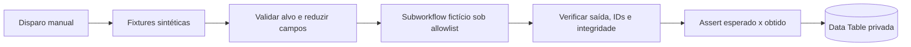

# V1.2 — Executor controlado de subworkflow fictício

A V1.2 adiciona **execução manual controlada** de um subworkflow de testes com dados sintéticos. O executor n8n tem um ID de alvo **estático**, não aceita um identificador de workflow vindo dos casos de teste e não contém chamadas de rede ou acesso a credenciais.



## Limites de segurança

- Apenas um alvo fictício, identificado logicamente como `LAB_SANDBOX_V1`; seu ID interno **não aparece** neste repositório.
- Todos os casos têm identificadores fictícios e não possuem entrada dinâmica do usuário ou código arbitrário.
- O executor envia ao alvo apenas identificador de caso, evento fictício, tentativas e confirmação.
- A referência pública usa `fakeTarget`; no n8n a invocação de subworkflow acontece pela node padrão **Execute Sub-workflow**, aguardando a conclusão.
- Validação obrigatória do número de saídas, IDs sem duplicação, tag do alvo e comparação por valores.
- Execução REPROVADA não equivale a crash de infraestrutura; ambos devem ser diferenciados.
- Histórico por execução, com `duration_ms=null` enquanto não for medido.

## Limitação importante

**O subworkflow está na mesma instância de n8n da empresa.** O isolamento é lógico (alvo permitido e sem credenciais), não significa container, banco, usuário de execução ou rede segregados. Não conectar workflows de produção, APIs, SQL ou mensageria nesta fase. Para isso será necessário um ambiente realmente isolado, mocks de integrações e permissão explícita.

## Resultado de validação

Testado no n8n com sete casos: **7/7 aprovados**. Uma divergência proposital foi detectada como **6/7 e REPROVADO**; a configuração normal foi restaurada e uma nova execução voltou a **7/7**. Os relatórios foram armazenados na tabela privada de histórico.

## Execução local de referência

```bash
node --test examples/automation-test-lab/*.test.mjs
```

Este exemplo é educacional, executado somente em memória e não chama n8n.
