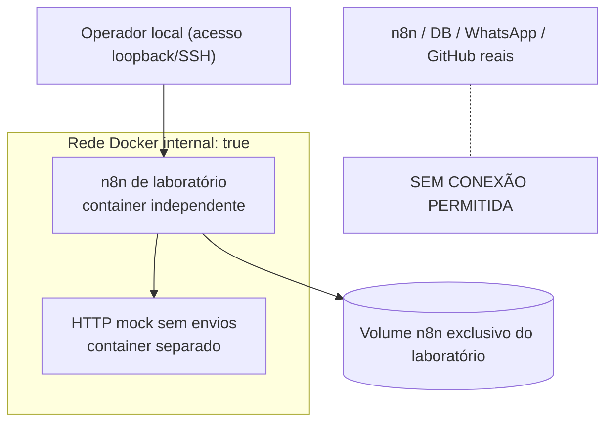

# V1.4 — Homologação segura e isolamento do laboratório

O objetivo desta fase é sair de um isolamento **lógico** (fixtures e allowlist em uma instância compartilhada) para um laboratório Docker independente, limitado a dados e integrações fictícias.

## Estado atual

- Um novo workflow **manual de pré-homologação** verifica 8 controles: instância, armazenamento, rede, bloqueio de egress, ausência de credenciais de produção, mocks, allowlist estática e logs sanitizados.
- O status começa como **BLOQUEADO**; mesmo uma configuração inteiramente preenchida permanece `PENDENTE_VERIFICACAO_EXTERNA`. O controle **nunca concede autorização para executar automações reais**.
- Auditoria separada registra somente chaves de controle e estado; não recebe tokens, endpoints ou logs empresariais.
- A instância Docker abaixo é apenas uma **proposta de implantação**, não foi criada automaticamente no servidor.

## Arquitetura proposta



A rede marcada `internal: true` restringe o acesso externo dos containers conectados apenas a ela. **Isso precisa ser confirmado no host real**, pois interfaces, políticas de firewall e variações de Docker podem alterar as propriedades efetivas. Compartilhar o mesmo host ainda não equivale a uma VM independente.

## Arquivos de referência

- `examples/homologation/compose.lab.yml`: define containers dedicados, rede interna, volume independente e painel acessível somente via `127.0.0.1:5688`.
- `examples/homologation/mock/server.py`: endpoint fictício `GET /health` e `POST /mock/notify`. Respostas contêm `delivered: false`, mesmo quando aceitas; `simulateFailure: true` força HTTP 503.
- `examples/homologation/.env.lab.example`: imagem n8n de exemplo. A versão e o digest precisam ser conferidos antes de implantar.
- `examples/homologation/.gitignore`: evita publicar chaves e arquivos do laboratório.

**Não copie** volume da produção, `.env` real, secrets, credenciais nem exportações de workflows operacionais para esse ambiente.

## Preparação manual — não execute na produção sem conferir recursos

A partir da pasta `examples/homologation`, escolha uma versão n8n testada e crie um arquivo local `.env.lab`:

```bash
cp .env.lab.example .env.lab
python3 -c "import secrets; print('LAB_ENCRYPTION_KEY='+secrets.token_hex(32))" >> .env.lab
docker compose --env-file .env.lab -f compose.lab.yml config --quiet
docker compose --env-file .env.lab -f compose.lab.yml up -d
```

No Windows/PowerShell, crie `.env.lab` manualmente usando o exemplo e cole a chave gerada pelo Python. O arquivo `.env.lab` **nunca deve ser versionado**.

Para acessar o editor a partir de outra máquina, use um túnel SSH local até o servidor, por exemplo `ssh -L 5688:127.0.0.1:5688 user@host`. Não altere o bind para `0.0.0.0` nem use domínio público sem autenticação e análise de segurança.

### Testes mínimos para gerar evidência de isolamento

1. Confirme que os dois containers e o volume pertencem a este Compose, e **não** à stack da produção: `docker compose --env-file .env.lab -f compose.lab.yml ps`.
2. Dentro de `lab-n8n`, verifique que a chamada para `http://lab-mock:8080/health` retorna HTTP 200.
3. Dentro de `lab-n8n`, verifique que `https://example.com` **não** é acessível. Caso haja conectividade de saída, a configuração é **REPROVADA** — não prossiga.
4. Verifique que não existe credencial, token, volume ou rota para a rede dos serviços reais.
5. Rode somente os casos fictícios, com respostas 200/503 do mock. Confirme que nenhum envio externo foi realizado.
6. Registre o resultado dos testes em documentos ou registros separados que contenham **somente dados técnicos sanitizados**. As referências devem ser IDs do tipo `LAB-EVIDENCE-...`, não URLs com tokens.
7. Submeta as evidências a uma revisão humana. Somente após validação independente poderá ser considerada uma etapa futura com integrações reais, em um ambiente explicitamente autorizado.

Exemplo de teste do mock dentro do container com Node.js (sem publicá-lo):

```bash
docker compose --env-file .env.lab -f compose.lab.yml exec -T lab-n8n node -e "fetch('http://lab-mock:8080/health').then(r=>r.json()).then(console.log)"
```

Teste de saída externa deve falhar e ser documentado (use timeout para não esperar indefinidamente):

```bash
docker compose --env-file .env.lab -f compose.lab.yml exec -T lab-n8n node -e "fetch('https://example.com',{signal:AbortSignal.timeout(3000)}).then(()=>{process.exitCode=2;console.log('FALHA DE ISOLAMENTO')}).catch(()=>console.log('Saida bloqueada'))"
```

> Esse teste é um indicador operacional, não uma auditoria formal de rede ou de segurança do hipervisor.

## Gate de pré-homologação

A configuração de demonstração usa `environmentClass='shared_instance'`, e cinco dos oito controles declarados estão pendentes. Mesmo com todos os controles declarados, a saída do gate é `PENDENTE_VERIFICACAO_EXTERNA` e `execution_authorized=false`. O fluxo permanece manual e não contém nodes capazes de disparar workflows operacionais.

## Critérios para a próxima versão

- Ambiente dedicado realmente implantado e evidências de isolamento revisadas.
- Estrutura mockada, sem credenciais e sem volumes de produção.
- Demonstração de testes positivos e falhas 503 sem efeitos externos.
- Aprovação explícita da equipe responsável pela infraestrutura.

**Não houve implantação de containers do laboratório no servidor nesta etapa.** O Compose e o mock são materiais para preparar e auditar essa implantação.
