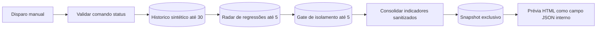

# Console do Laboratório — V1.5 (sem Docker)
O n8n operacional já possui suites sintéticas, um radar e um gate de segurança. Esta etapa adiciona um **workflow independente e manual de consulta** dentro do mesmo projeto n8n.

## Arquitetura do console n8n



- **Comando único**: `status`. Qualquer tentativa de `execute`, de trocar alias ou de habilitar execução real falha antes de consultar ou gravar dados.
- **Não chama workflows reais ou fictícios**: consolida apenas os resultados **já existentes** nas Data Tables.
- **Métricas obtidas**: última baseline sintética validada, último radar e último gate.
- **Bloqueio de homologação permanente**: sem ambiente Docker segregado e evidências, o console não libera testes de produção.
- **Não existe URL de interface pública**: a prévia HTML é um campo `html_preview` gerado no último Code node, visível somente no editor/resultado da execução n8n. Não há webhook ativo, endpoint ou rota nova no Copiloto TI.
- **Armazenamento segregado**: snapshots em uma nova Data Table privada; tabelas de origem ficam intactas.
- **Execução manual**: node Manual Trigger, sem cron e workflow não publicado.

## Verificações realizadas

- Execução manual retornou **7/7 casos sintéticos**, **zero regressões** no último radar e gate de homologação **BLOQUEADO**, com 3/8 controles declarados.
- Um teste negativo mudou `command` para `execute`: o workflow interrompeu com `ONLY_READ_ONLY_STATUS_ALLOWED` antes de gravar um snapshot.
- A configuração `status` foi restaurada e uma nova execução passou, com snapshot salvo e HTML estático disponível.
- O código público de referência reproduz essas regras em memória, sem IDs internos ou dados corporativos.

## Segurança e próximos passos
Este console é apenas **orquestração de evidências**, não um executor de suites. O executor V1.2 continua separado, manual e com alvo fictício fixo. Para permitir testes de processos reais, ainda precisamos implantar e auditar um **ambiente Docker separado**, com isolamento de volumes, rede, egress, mocks, credenciais próprias e revisão humana. Não ligar este console a um webhook público enquanto não houver autenticação e autorização por usuário.

```bash
node --test examples/automation-test-lab/*.test.mjs
```
